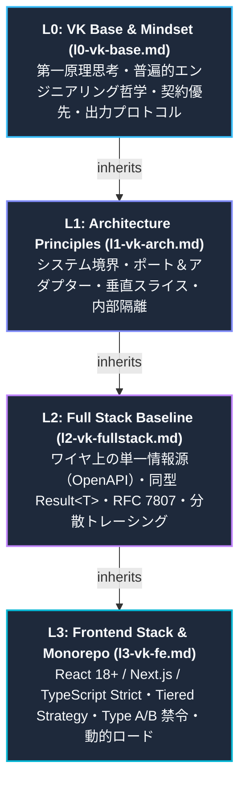

# VK.Blocks Frontend AI ガバナンス・エコシステム

このディレクトリには、人間と AI エージェントの自律的かつ確定的（Deterministic）な協調開発を実現するための **AI Governance Protocol（工業製品水準の設計思想・Industrial DNA）** が格納されています。

---

## 🌟 新思想：階層型AIガバナンス (Hierarchical AI Governance)

本プロジェクトでは、単一の長大な指示プロンプトによる「ルールの形骸化」や「推論のブレ（Rule Drift）」を根本から解決するため、**厳格な単方向継承（Unidirectional Layering）** と **多層化されたルール体系（L0〜L3）** を採用しています。



### 1. 厳格な単方向継承モデル (`inherits`)
- **単方向依存**: 依存の向きは常に下位（基底層）に向かいます。上位レイヤーは下位レイヤーの制約を厳格化（Tighten）できますが、**緩和（Relax）することは例外なく禁止** されます。
- **Contract-First (契約優先)**: インターフェース、型定義、Zod Schema、エラー定数を実装コードに先立って定義します。
- **Zero Implicit Globals**: 静的変更可能状態や暗黙のシングルトンを排除し、時刻、ID生成、ストレージ、ログ等はすべて抽象化（Provider/Context/Adapter）を介して注入します。
- **クロススタック整合（バックエンド連携）**: L0〜L2 レイヤーはバックエンド（VK-Common-BE）と完全に対齊・共有されており、ワイヤ上の契約（OpenAPI、`VKResult<T>`、RFC 7807、W3C `traceparent`）を通じて両端が独立して同一の仕様を満たします。

---

## 🏛️ 三層協調アーキテクチャ (Tri-Layered Collaboration)

AI エコシステムは責任に応じて 3 つの層に分離されています：

| レイヤー | ディレクトリ | 役割 | 動作特性 |
| :--- | :--- | :--- | :--- |
| **1. Rules (規約・憲法)** | [/.agents/rules/](/.agents/rules/) | タスクの内容に関わらず遵守すべき **絶対的なアーキテクチャ制約** | 静的・不変のルール体系（L0〜L3） |
| **2. Skills & Blueprints (手順・型)** | [/.agents/skills/](/.agents/skills/) & [/docs/00-Blueprints/](/docs/00-Blueprints/) | RFC、Manifest、ADR、契約仕様、監査、バックログ等の **認知推論パイプラインと単一情報源テンプレート** | スラッシュコマンド（例: `/vk-draft-*`, `/vk-audit-*`）および文脈に応じた自動スキル起動 |
| **3. MCP & CLI Tools (メカニクス)** | [/tools/vk-blocks-fe-manager/](/tools/vk-blocks-fe-manager/) & `@vk-blocks/cli` | AST解析、依存境界検証、ルール抽出、連番採番、自動スキャフォールド等の **決定的・機械的処理** | 100% 確定的なツール実行（`vk-blocks-fe-manager`, `@vk-blocks/cli`, `dependency-cruiser`） |

---

## 🛰️ 階層制ルール適用プロトコル (Tiered Strategy)

AI のコンテキストウィンドウ枯渇と注意力の散漫（Lost-in-the-Middle）を防止するため、**Tiered Strategy** による二段構えのルール適用を行います：

```text
[常時ロード層 (Always-On System Prompt)]
 ├── l0-vk-base.md       (L0: 基底思想)
 ├── l1-vk-arch.md       (L1: アーキテクチャ原則)
 ├── l2-vk-fullstack.md  (L2: フルスタック境界契約)
 └── l3-vk-fe.md         (L3: フロントエンド技術スタック)
      ├── Tier 1: Rule Index (全ルール 1 行サマリ / 認知維持)
      ├── Tier 2: Core Prohibitions (Type A/B 即時禁令)
      └── Tier 3: Dynamic Loading Protocol (動的ロード手順)

[オンデマンド動的ロード層 (Tier 3: trigger: manual)]
 ├── l3-vk-fe-cs-core-standards.md
 ├── l3-vk-fe-or-observability-resiliency.md
 ├── l3-vk-fe-dl-development-lifecycle.md
 ├── l3-vk-fe-ap-architecture-patterns.md
 ├── l3-vk-fe-mb-module-blueprint.md
 └── l3-vk-fe-ps-planning-standards.md
```

### 1. 常時ロード層 (Always-On)
- **Tier 1 (Rule Index)**: 全ルールの要約を常に AI の視界に置き、ルールの存在忘れをゼロにします。
- **Tier 2 (Core Prohibitions)**: 違反が即座に設計崩壊を招く制約を直接インライン化。
  - **Type A (🔴 Logic Bottom Line - 絶対禁令)**: 安定性と決定論を司る絶対規約（`CS.01`, `CS.03`, `CS.06`, `CS.07`, `OR.01`, `AP.01`, `AP.06`, `AP.07`, `PS.04`, `PS.05`）。Labs 環境を含め一切の例外を認めません。
  - **Type B (🟡 Industrial Habits - 工業標準)**: 命名・配置規約（`AP.03`, `MB.03`, `MB.06`, `DL.02`〜`DL.05`）。原則厳守、`src/labs` で明示的に許可された場合のみ免除可能です。

### 2. オンデマンド動的ロード層 (Tier 3: Dynamic Loading)
- 詳細仕様（`l3-vk-fe-*.md`）は `trigger: manual` としてシステムプロンプト外に配置。
- **Hard-Lock 原則**: AI が記憶や要約から推測でコードを出力することを厳禁とし、シナリオに応じて MCP ツール（`vk_fe_get_architectural_rule`）を呼び出し、最新の詳細仕様を同期（Sync）した上でコードを出力します。

---

## 🛡️ 出力プロトコルと監査 (Output Protocol & Traceability)

すべてのコード生成・ADR・マニフェスト出力において、以下の規約遵守が義務付けられています：

### 1. ハンドシェイク (The Handshake)
回答の **先頭1行目** に、アクティブなレイヤー、対象パス、および同期した Rule ID を明記します：
```text
Active: [L0-L3:Auth] | Context: packages/auth | Sync: [CS.01, AP.01, MB.01]
```
> **Hard-Lock**: 該当シナリオに必要な Rule ID が `Sync: [...]` に含まれていない場合、コード生成は禁止されます。

### 2. 監査タグ (Audit Tag)
回答の末尾で自己監査ステータスを宣言します：
- 準拠時: `Audit: ✅`
- 違反・免除時: `Audit: 🚩 [RuleID] {Rationale}`（Type B 免除の理由を明記。即時自己修正を実施）

---

## 🧠 AI コンテキスト・エントロピー制御理論 (Context & Entropy Governance)

長時間のペアプログラミングにおいて、AI が初期規約を忘却したり自己解釈に陥る現象（ルールのドリフト / Rule Drift）を防ぐためのアプローチです：

1. **Lost-in-the-Middle 対策**:
   重要なアーキテクチャ規約は常時ロード層（L0〜L3）に凝縮し、動的ロードされた最新ルールをコンテキストの「最も新しい領域」に再注入します。
2. **Differential Loading (差分ロード)**:
   パッケージ作業時はまず `vk_fe_get_module_context` でモジュール固有の設計方針（Manifesto / Prompts）を取得し、不足している共通ルールのみを `vk_fe_get_architectural_rule` でピンポイントに補充します。
3. **決定論的アライメント**:
   AI に記憶から「思い出す」のではなく「MCP を介して確定的な外部ソースから再取得させる」ことで、ハルシネーションの余地を排除します。

---

## 🛠️ クイックリファレンス

### 開発者（人間）向け
- **規約の確認**: [/.agents/rules/](/.agents/rules/) 配下のドキュメントが、フロントエンド全体の設計・コーディング標準の Single Source of Truth（唯一の基準）です。
- **エンタープライズ開発ライフサイクル標準フロー (`00-Blueprints` 連動)**:
  新機能やパッケージの開発は、単一情報源テンプレート群（`00-Blueprints`）に基づき、確定的なパイプラインに沿って推進します：

```mermaid
flowchart LR
    S1["<b>01. 立項</b><br/><code>/vk-draft-rfc</code><br/>RFC提案策定"] -->
    S2["<b>02. 境界</b><br/><code>/vk-draft-architecture</code><br/>アーキテクチャ・境界設計"] -->
    S3["<b>03. 決定</b><br/><code>/vk-draft-adr</code><br/>設計決定記録 (ADR)"] -->
    S4["<b>04. 契約</b><br/><code>/vk-draft-impl-plan</code><br/>実装仕様・型・エラー定義"] -->
    S5["<b>05. 監査</b><br/><code>/vk-audit-*</code><br/>アーキテクチャ・DNA監査"] -->
    S6["<b>06. 課題</b><br/><code>/vk-add-backlog</code><br/>タスク起票・Sprint連携"]

    style S1 fill:#1e293b,stroke:#38bdf8,stroke-width:1.5px,color:#f8fafc
    style S2 fill:#1e293b,stroke:#818cf8,stroke-width:1.5px,color:#f8fafc
    style S3 fill:#1e293b,stroke:#a855f7,stroke-width:1.5px,color:#f8fafc
    style S4 fill:#1e293b,stroke:#ec4899,stroke-width:1.5px,color:#f8fafc
    style S5 fill:#1e293b,stroke:#f59e0b,stroke-width:1.5px,color:#f8fafc
    style S6 fill:#1e293b,stroke:#10b981,stroke-width:1.5px,color:#f8fafc
```



#### 🧩 提供スキル一覧 (Available Skills)

| スラッシュコマンド | 分類 | 概要 | 連携先 / 主な成果物 |
| :--- | :--- | :--- | :--- |
| [`/vk-draft-rfc`](/.agents/skills/vk-draft-rfc/SKILL.md) | ライフサイクル (01) | RFC 立項（新機能・新パッケージ・UI/UX 提案の文書化） | `/docs/02-RFCs/`<br/>([02-RfcBlueprint.md](/docs/00-Blueprints/02-RfcBlueprint.md)) |
| [`/vk-draft-architecture`](/.agents/skills/vk-draft-architecture/SKILL.md) | ライフサイクル (02) | パッケージ全景・アーキテクチャ図解・レイヤー境界の生成 | `/docs/03-Architecture/`<br/>([03-ArchitectureBlueprint.md](/docs/00-Blueprints/03-ArchitectureBlueprint.md)) |
| [`/vk-draft-adr`](/.agents/skills/vk-draft-adr/SKILL.md) | ライフサイクル (03) | アーキテクチャ決定レコード (ADR) の策定・自動採番記録 | `/docs/04-ArchitectureDecisionRecords/`<br/>([04-AdrBlueprint.md](/docs/00-Blueprints/04-AdrBlueprint.md)) |
| [`/vk-draft-impl-plan`](/.agents/skills/vk-draft-impl-plan/SKILL.md) | 実装計画 (Plan) | 実装契約・Component Anatomy・エラー一覧・詳細設計の策定 | Implementation Plan<br/>([Plan-ContractAndImplementationBlueprint.md](/docs/00-Blueprints/Plan-ContractAndImplementationBlueprint.md)) |
| [`/vk-audit-architecture`](/.agents/skills/vk-audit-architecture/SKILL.md) | 監査・検証 (05) | dependency-cruiser を用いたパッケージ境界・DNA 深層監査 | `/docs/04-AuditReports/`<br/>([06-ArchitectureAuditBlueprint.md](/docs/00-Blueprints/06-ArchitectureAuditBlueprint.md)) |
| [`/vk-audit-fast`](/.agents/skills/vk-audit-fast/SKILL.md) | 監査・検証 | チェックリスト・grep 方式による高速インライン構造監査 | チャット（インライン出力） |
| [`/vk-audit-semantic`](/.agents/skills/vk-audit-semantic/SKILL.md) | 監査・検証 | Industrial DNA (Result<T>, AbortSignal, vkAssert) 整合性検証 | チャット（インライン出力） |
| [`/vk-add-backlog`](/.agents/skills/vk-add-backlog/SKILL.md) | ライフサイクル (06) | バックログ起票および Active Sprint への自動同期 | `/docs/05-Backlogs/`<br/>([07-BacklogItemBlueprint.md](/docs/00-Blueprints/07-BacklogItemBlueprint.md)) |
| [`/vk-init-new-package`](/.agents/skills/vk-init-new-package/SKILL.md) | 生成・構築 | 新規 Monorepo パッケージの初期化・ボイラープレート配置 | `/packages/{packageName}/` |
| [`/vk-code-normalization`](/.agents/skills/vk-code-normalization/SKILL.md) | 品質・正規化 | ESLint 修正 + Industrial DNA 準拠の AI コード意味論正規化 | 対象ファイル / ディレクトリ |
| [`/vk-normalize-mechanical`](/.agents/skills/vk-normalize-mechanical/SKILL.md) | 品質・正規化 | 物理境界・Linter 自動修復による軽量・機械的コード正規化 | 対象パッケージ / ルート |
| [`/vk-docs-normalize-links`](/.agents/skills/vk-docs-normalize-links/SKILL.md) | ドキュメント | 全 Markdown 内部リンクのルート相対パス正規化 (`BASE-11`) | リポジトリ全域の `.md` |
| [`/vk-generate-pr-summary`](/.agents/skills/vk-generate-pr-summary/SKILL.md) | 運用・Git | git diff からの DoD 準拠 PR 説明文（日本語）自動生成 | チャット（Markdown 出力） |
| [`/vk-copy-file`](/.agents/skills/vk-copy-file/SKILL.md) | ユーティリティ | 指定先への安全なファイルコピー | 指定ファイル |
| [`/vk-generate-readme`](/.agents/skills/vk-generate-readme/SKILL.md) | ドキュメント | パッケージ単位の証拠駆動型 README.md 自動生成 | 各パッケージルート |
| [`/vk-generate-root-readme`](/.agents/skills/vk-generate-root-readme/SKILL.md) | ドキュメント | Monorepo 全体を俯瞰するルート README.md 自動生成 | ルート `README.md` |
| [`/tutor-mode`](/.agents/skills/tutor-mode/SKILL.md) | 支援・伴学 | バックエンド／DDD 思考を橋渡しする対話型フロントエンド伴学 | チャット（学習セッション） |

---

### AI エージェント向け
1. **Bootstrap**: パッケージ初動時は `vk_fe_get_module_context(modulePath)` でローカル指示を取得せよ。
2. **Dynamic Sync**: 変更内容に応じた Rule ID を `vk_fe_get_architectural_rule(ruleIds)` で取得し、Handshake 行を宣言せよ。
3. **Strict Compliance**: Type A 規約（`Result<T>` 必須、`AbortSignal` 伝播、`vkAssert` 境界防御、Provider Fail-Fast、`PS.05` 確据原則）を徹底せよ。
4. **Audit**: 回答末尾で `Audit: ✅` または違反フラグ（`Audit: 🚩 [RuleID]`）を出力せよ。

