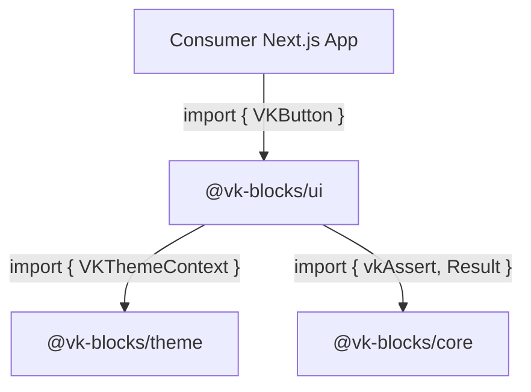
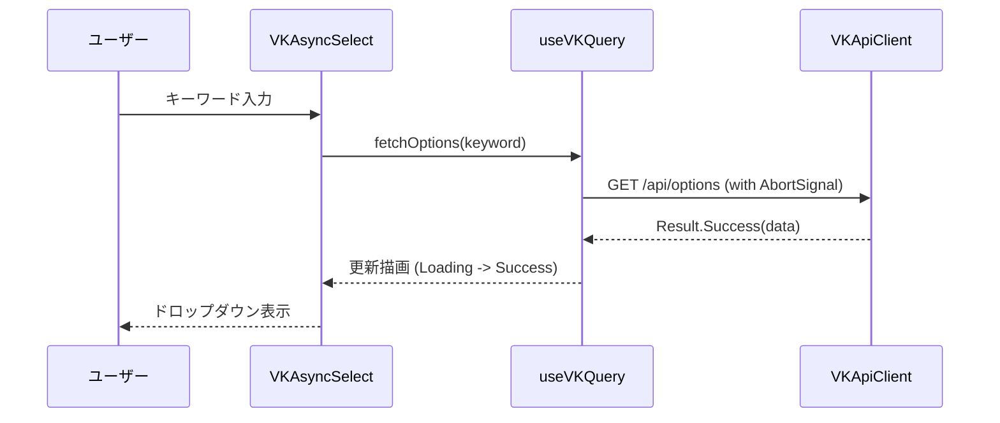

# Task: パッケージ・アーキテクチャ仕様書およびシステム全景の策定 (Frontend Architecture Blueprint)

# Role

あなたは、エンタープライズ C4 モデル（Context, Container, Component）、単方向レイヤリング（`ARCH-01`）、Server/Client 境界制御（`AP.02`）、および Monorepo パッケージ設計（`MB.01`）を統括するチーフ・フロントエンドアーキテクトです。

# Goal

`VK.Blocks` フロントエンドにおけるアーキテクチャ仕様書を、**「全社 Monorepo 全景 (Global Landscape)」** と **「個別パッケージ仕様 (Package Architecture)」** の二層構造で明文化し、人間および AI が大局観と境界ルールを完全に把握できる仕様書体系を策定します。

---

## 🏛️ アーキテクチャドキュメント二層体系と生成成果物一覧

```text
docs/03-Architecture/
├── README.md                                  # 🌍 [Tier 1: 必須] グローバル・フロントエンドアーキテクチャ全景
│
├── {packageName}/                             # 📦 [Tier 2: 必須] 個別パッケージ別ディレクトリ
│   ├── README.md                              # 🏛️ [必須] パッケージアーキテクチャ仕様書 (C4, 境界, レイヤー依存, ADR索引)
│   ├── api-surface.md                         # 📜 [強く推奨] 公開 API 面・エクスポート境界と SemVer 契約 (ARCH-07, AP.03)
│   ├── component-hierarchy.md                 # 🎨 [UI パッケージ] コンポーネントツリーと Props/Slot 構成
│   ├── state-lifecycle.md                     # 🔄 [状態パッケージ] 状態マシン、キャッシュ無効化、永続化境界 (AP.04, AP.07)
│   ├── rsc-boundaries.md                      # ⚡ [ハイブリッド時] Server Component / Client Component 境界とデータテイント
│   ├── failure-modes.md                       # 💥 [通信・外部SDK時] 障害モード、フォールバック表示と Error Boundary
│   └── accessibility.md                       # ♿ [UI パッケージ] WCAG 2.1 AA 準拠マトリクスとキーボードマップ
```

| 階層 / 種別 | ファイルパス | 責務と主な記述内容 | 作成・更新タイミング |
| :--- | :--- | :--- | :--- |
| **Tier 1<br/>Global** | `docs/03-Architecture/README.md` | **全社 Monorepo 全景・横断アーキテクチャ**<br/>• 全 25+ パッケージのレイヤー配置地図（L0〜L3）<br/>• パッケージ間依存マトリクス（`.dependency-cruiser.cjs` 整合性）<br/>• 共通実行コンテキスト（テーマ、認証、ロギング）の伝播経路 | 基盤刷新時、新パッケージ追加時 |
| **Tier 2<br/>Package** | `docs/03-Architecture/{packageName}/README.md` | **パッケージアーキテクチャ仕様書（本 blueprint の主対象）**<br/>• 当該パッケージの C4 Context & Container 図<br/>• 内部ディレクトリ構造（`src/components/`, `src/_internal/`）<br/>• 主要ランタイムシーケンス（データフェッチ、レンダリングフロー）<br/>• 主要 ADR 索引 | 新パッケージ立項時、大規模リファクタ時 |
| **Tier 2<br/>Companion** | `docs/03-Architecture/{packageName}/api-surface.md` | **公開 API 面と後方互換性ポリシー (`ARCH-07`, `AP.03`, `FS-09`)**<br/>• `src/index.ts`（VK プレフィックス）と `src/_internal/` の厳格な白黒分離<br/>• SemVer 破壊的変更判定基準（Props 削除・名称変更）<br/>• AI コーディングエージェント向けの「変更不可契約」明示 | 公開 API 策定時、破壊的変更審査時 |
| **Tier 2<br/>Companion** | `docs/03-Architecture/{packageName}/rsc-boundaries.md` | **Server / Client 境界設計 (`AP.02`)**<br/>• RSC と `"use client"` の物理配置境界<br/>• クライアントバンドルへの不要コード混入防止設計<br/>• 機微データのクライアント漏洩防止（`server-only` / データテイント） | Next.js App Router 連携モジュール |
| **Tier 2<br/>Companion** | `docs/03-Architecture/{packageName}/accessibility.md` | **アクセシビリティ仕様書 (`MB.06`)**<br/>• キーボードナビゲーションマッピング（Tab, Enter, Escape, ArrowKeys）<br/>• WAI-ARIA ロールおよびステート（`aria-expanded`, `aria-controls`）<br/>• スクリーンリーダー向けのアナウンス方針（`aria-live`） | UI プリミティブ・コンポーネント |

---

# Package Architecture Template (Must Follow for `{packageName}/README.md`)

```markdown
# 🏛️ Architecture: `@vk-blocks/{packageName}`

- **Package ID**: `@vk-blocks/{packageName}`
- **Domain / Area**: `[UI Primitives / State / Core / Transport / Pro-UI / Tools]`
- **Primary Owner**: Frontend Architecture Team
- **Target Layer**: [L0 Foundation / L1 Primitives / L2 Domain Blocks / L3 Apps]
- **Status**: 📝 Draft / 🏛️ Accepted / 🔄 Superseded
- **Last Verified**: {YYYY-MM-DD}

---

## 1. 🎯 概要と範囲 (Overview & Scope)

### 1.1 エレベーターピッチ・要約 (Elevator Pitch)
- [このパッケージが解決する本質的なフロントエンド課題を 1〜2 文で明確に定義]

### 1.2 スコープ境界 (Goals & Non-Goals — `BASE-06`)
- **包含する領域 (In-Scope / Goals)**:
  - [提供するコンポーネント、フック、型、および保証する不変条件]
- **明確に除外する領域 (Out-of-Scope / Non-Goals)**:
  - [意図的に本パッケージでは扱わず、他パッケージや App レイヤーに委譲する関心事]

---

## 2. ⚡ アーキテクチャ牽引要因 (Architectural Drivers)

### 2.1 主要品質属性 (Quality Attributes)
- **レンダリング性能・メモリ (`AP.01`, `CS.04`)**: [不要な再レンダリング防止、仮想化、メモ化戦略]
- **バンドルサイズ予算 (`size-limit`)**: [Tree-shaking 対応、外部巨大ライブラリ依存の排除]
- **アクセシビリティ (WCAG 2.1 AA — `MB.06`)**: [キーボード操作完全網羅、ARIA 整合性]
- **型安全性・決定論 (`AP.01`)**: [strict: true, any ゼロ, Discriminated Unions]

---

## 3. 🗺️ システム境界と C4 モデル (Context & Container View)



---

## 4. 🔄 主要ランタイム時系列図 (Sequence View)



---

## 5. 📚 関連 ADR 索引 (Architecture Decision Records)
- [ADR-001: Decouple Server State](/docs/04-ArchitectureDecisionRecords/query/README.md)
```
