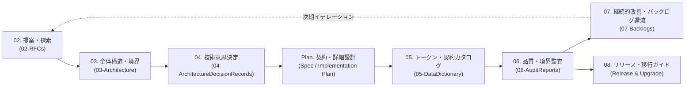

# 📐 VK.Blocks Frontend Engineering Blueprints (`00-Blueprints`)

このディレクトリには、`VK.Blocks` フロントエンドのエンタープライズ開発ライフサイクル（**提案 → 境界定義 → 意思決定 → 契約・実装設計 → 契約カタログ → アーキテクチャ監査 → バックログ還流 → リリース公開**）の各フェーズで使用する標準テンプレートおよび AI Agent 用プロンプト（Blueprints）が格納されています。

---

## 🔄 エンタープライズ開発ライフサイクルと Blueprints の対応表

| 順序 / 識別番号 | フェーズ (SDLC Stage) | Blueprint ファイル | 出力先ディレクトリ | 関連ルール / MCP ツール |
| :---: | :--- | :--- | :--- | :--- |
| **02** | **立項・概念探索 (RFC)** | [02-RfcBlueprint.md](./02-RfcBlueprint.md) | `docs/02-RFCs/` | `PS.03`, `BASE-06` / `/vk-draft-rfc` |
| **03** | **全体構造・境界設計 (Architecture)** | [03-ArchitectureBlueprint.md](./03-ArchitectureBlueprint.md) | `docs/03-Architecture/` | `BASE-12`, `ARCH-01`〜`13` / `/vk-draft-architecture` |
| **04** | **アーキテクチャ意思決定 (ADR)** | [04-AdrBlueprint.md](./04-AdrBlueprint.md) | `docs/04-ArchitectureDecisionRecords/` | `DL.03`, `PS.02` / `vk_fe_draft_adr` |
| **Plan** | **契約先行・詳細実装計画 (Contract & Spec)** | [Plan-ContractAndImplementationBlueprint.md](./Plan-ContractAndImplementationBlueprint.md) | Implementation Plan | `BASE-01`, `PS.01`, `MB.01`〜`06`, `AP.01`〜`07` |
| **05** | **トークン・公開契約カタログ (Data Dictionary)** | [05-DataDictionaryBlueprint.md](./05-DataDictionaryBlueprint.md) | `docs/05-DataDictionary/` | `FS-01`, `FS-02`, `@vk-blocks/theme`, `OR.01` |
| **06** | **深層アーキテクチャ監査 (Audit)** | [06-ArchitectureAuditBlueprint.md](./06-ArchitectureAuditBlueprint.md) | `docs/06-AuditReports/` | `vk_fe_audit_architecture`, `depcruise` |
| **07** | **技術的負債・タスク管理 (Backlog)** | [07-BacklogItemBlueprint.md](./07-BacklogItemBlueprint.md) | `docs/07-Backlogs/` | `DL.04` / `vk_fe_add_backlog_item` |
| **08** | **パッケージ公開・移行ガイド (Release & Upgrade)** | [08-ReleaseNoteBlueprint.md](./08-ReleaseNoteBlueprint.md) | Release Notes / Changelog | `ARCH-04`, `ARCH-07`, `FS-09`, Changeset |

---

## 🎯 使い分けガイド (When to Use Which Blueprint)

1. **新しいパッケージや複雑な UI/UX システム（ストリーミング、仮想化、リアルタイム等）を立ち上げるとき**
   - まず [02-RfcBlueprint.md](./02-RfcBlueprint.md) を使って `docs/02-RFCs/` に提案を作成し、`Goals` / `Non-Goals`、概念メタファー、および UI/UX Wireframe を合意します。
2. **パッケージの全体構造やシステム境界を策定するとき**
   - [03-ArchitectureBlueprint.md](./03-ArchitectureBlueprint.md)（およびグローバル総綱である [docs/03-Architecture/README.md](../03-Architecture/README.md)）に従い、`docs/03-Architecture/{packageName}/` に C4 Context/Container 図、コンポーネントツリー、および RSC 境界仕様書を策定します。
3. **設計上のトレードオフや Public API・Provider 設計の重要決定を行うとき**
   - [04-AdrBlueprint.md](./04-AdrBlueprint.md)（または `vk_fe_draft_adr`）を使用し、`docs/04-ArchitectureDecisionRecords/{packageName}/` に決定事項と代替案の却下理由を記録します。
4. **具体的な機能やコンポーネントの実装に入る前**
   - [Plan-ContractAndImplementationBlueprint.md](./Plan-ContractAndImplementationBlueprint.md) に従い、`PS.01` 決定監査チェック、ファイル配置（`MB.01`）、Props / 型契約（`AP.01`）、エラー定数（`CS.01`）、5つの状態（Idle/Loading/Success/Empty/Error）、Provider 設計（`MB.03`, `AP.06`）を確定させてからコーディングを開始します。
5. **デザイン変数・エラーコード・計測イベント・キャッシュキーの一覧を整理するとき**
   - [05-DataDictionaryBlueprint.md](./05-DataDictionaryBlueprint.md) に従い、`docs/05-DataDictionary/` にカタログを公開・同期します。
6. **実装完了後のレビュー・品質検証を行うとき**
   - [06-ArchitectureAuditBlueprint.md](./06-ArchitectureAuditBlueprint.md) に基づいて Phase 1〜4 の深層監査を実施し、レポートを `docs/06-AuditReports/` に保存します。
7. **監査で検出された課題や将来のロードマップをタスク化するとき**
   - [07-BacklogItemBlueprint.md](./07-BacklogItemBlueprint.md)（`vk_fe_add_backlog_item`）を使用し、`docs/07-Backlogs/` に優先度付きのアトミックなタスクとして登録します。
8. **新バージョン公開・Breaking Change 発生時の移行案内を作成するとき**
   - [08-ReleaseNoteBlueprint.md](./08-ReleaseNoteBlueprint.md) に従い、Before/After の移行コードスニペットとバンドルサイズ差分を明記したリリースノートを作成します。
